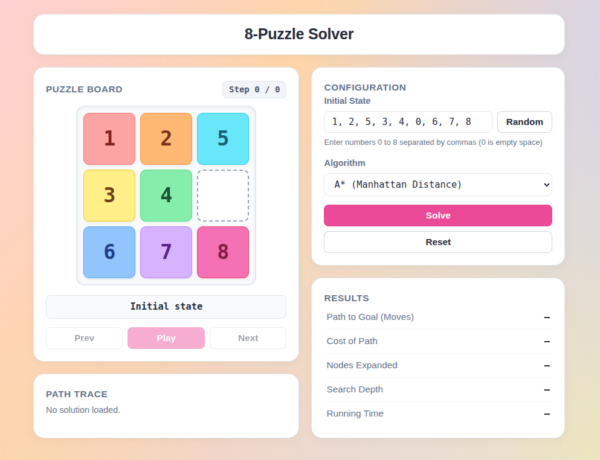

<div align="center">

# 8-Puzzle Solver

*An interactive 8-puzzle solver that visualizes BFS, DFS, IDFS, and A search algorithms — with step-by-step animation, manual play mode, and a clean web interface served by Flask.*


</div>

---

## Overview

The 8-puzzle solver takes any valid initial board configuration and finds the solution path using one of five algorithms: BFS, DFS (depth-limited), IDFS, A* with Manhattan distance, or A* with Euclidean distance. The frontend animates each step of the solution at a fixed pace, showing the move direction and step count at every frame. Users can also solve the puzzle manually by clicking tiles — the board detects when the goal state is reached and responds accordingly. Results include path cost, nodes expanded, search depth, and running time.

---

## Screenshot

<p align="center">
  
</p>

---

## Features

- **Five search algorithms:** BFS, DFS (depth-limited to 50), IDFS, A* Manhattan, A* Euclidean
- **Step-by-step animation:** plays the solution path at a fixed 900ms per step with prev/next/play controls
- **Manual play mode:** click tiles adjacent to the blank to move them; goal state is detected automatically
- **Solvability check:** rejects unsolvable boards before running any search
- **Result metrics:** path cost, nodes expanded, search depth, and running time per solve
- **Path trace panel:** lists every move direction in the solution sequence

---

## Architecture

| Component | Technology | Role |
|-----------|------------|------|
| **Puzzle State** | Python (`puzzle.py`) | `PuzzleState` dataclass with `get_children()`, `trace_path()`, heuristics, and solvability check |
| **Search Solvers** | Python (`solver/`) | One module per algorithm — all return a uniform dict of path, moves, cost, and metrics |
| **API** | Flask (`app.py`) | Single `/solve` POST endpoint — validates input, dispatches to the right solver, returns JSON |
| **UI** | Vanilla JS + CSS | Renders the board grid, drives animation playback, handles manual tile clicks |

---

## Tech Stack

| Layer | Technology |
|-------|------------|
| Backend | Python 3, Flask |
| Algorithms | BFS, DFS, IDFS, A* (Manhattan & Euclidean) |
| Frontend | HTML, Vanilla JavaScript, CSS |

---

## Running Locally

**Prerequisites:** Python 3.10+

```bash
# install dependencies
python -m venv .venv
source .venv/bin/activate
pip install -r requirements.txt

# run the app
python app.py
```

App available at `http://127.0.0.1:5000`

---

## Authors

Jana Rashed · Esraa AbdElHay
